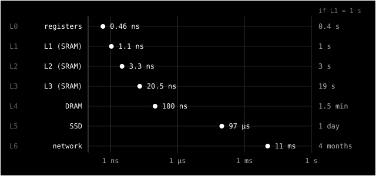

> **Série CSAPP** — notas de leitura de _Computer Systems: A Programmer's Perspective_, uma seção
> por vez. Todos os posts ficam em [#csapp](/tags/csapp/). Anterior:
> [§1.5 — Caches importam](/posts/csapp-1-5-caches-importam/).
> _[Read in English](/posts/csapp-1-6-memory-hierarchy/)._

Na [seção anterior](/posts/csapp-1-5-caches-importam/), vimos que uma memória pequena e rápida entre
a CPU e uma memória grande e lenta (a cache) muda o desempenho em uma ordem de grandeza. A seção 1.6
é curta e dá um passo além: essa ideia não vale só para as caches. Ela organiza **todo** o
armazenamento de um computador.

## O que o livro diz

Todo sistema organiza seus dispositivos de armazenamento numa **hierarquia de memória**. Descendo
na hierarquia, os dispositivos ficam mais lentos, maiores e mais baratos por byte:

| Nível | Dispositivo                             |
| ----- | --------------------------------------- |
| L0    | registradores                           |
| L1    | cache L1 (SRAM)                         |
| L2    | cache L2 (SRAM)                         |
| L3    | cache L3 (SRAM)                         |
| L4    | memória principal (DRAM)                |
| L5    | armazenamento local (discos)            |
| L6    | armazenamento remoto (rede, servidores) |

E a ideia central cabe numa frase: **cada nível serve de cache para o nível de baixo**. Os
registradores são cache da L1. A L1 é cache da L2, que é cache da L3, que é cache da memória
principal. A memória principal é cache do disco. E o disco local pode ser cache de dados guardados em
outras máquinas.

O livro fecha dizendo que, assim como dá para explorar as caches, dá para explorar a hierarquia
inteira. O capítulo 6 trata disso em detalhe.

## Medindo a escada inteira

Na [seção 1.5](/posts/csapp-1-5-caches-importam/) medi os níveis L1 a L4. Agora quis completar a
escada, do registrador até a rede:

- **L0:** um loop de somas em registrador, cada uma dependendo da anterior.
- **L1 a L4:** o mesmo teste de lista encadeada da seção anterior.
- **L5:** leituras aleatórias de 4 KiB num arquivo de 1 GiB no SSD, com `O_DIRECT` para não passar
  pelo cache do kernel.
- **L6:** `ping` até o servidor do GitHub Pages, onde este blog está hospedado.



| Nível | O que medi                                   | Latência | Se a L1 levasse 1 s |
| ----- | -------------------------------------------- | -------- | ------------------- |
| L0    | soma em registrador (com o controle do loop) | ~0,46 ns | 0,4 s               |
| L1    | lista encadeada, 4–32 KiB                    | ~1,1 ns  | 1 s                 |
| L2    | lista encadeada, 64–512 KiB                  | ~3,3 ns  | 3 s                 |
| L3    | lista encadeada, 4 MiB                       | ~20 ns   | 19 s                |
| L4    | lista encadeada, 128 MiB ou mais             | ~100 ns  | 1,5 min             |
| L5    | leitura aleatória de 4 KiB no SSD            | ~97 µs   | 1 dia               |
| L6    | ida e volta até o GitHub Pages               | ~11 ms   | 4 meses             |

Do primeiro ao último nível são quase **nove ordens de grandeza**. A coluna da direita ajuda a
sentir isso: se buscar um dado na L1 levasse um segundo, buscar no SSD levaria um dia, e mandar um
pacote até o servidor do blog e receber a resposta levaria quatro meses.

## A memória como cache do disco

O livro diz que a memória principal é cache do disco. Dá para ver isso direto. Repeti as mesmas
leituras aleatórias de 4 KiB, mas agora sem `O_DIRECT`, depois de ler os blocos uma primeira vez:

```text
SSD (O_DIRECT)     97.48 us
page cache          0.82 us
```

Na segunda rodada, os dados vieram do **page cache**: a parte da memória principal que o Linux usa
para guardar pedaços de arquivos lidos recentemente. A leitura ficou cerca de **100 vezes** mais
rápida, e o pouco mais de 1 µs que sobrou é basicamente o custo da chamada de sistema e da cópia.

## Caches até na rede

Os níveis de baixo também têm caches. Pedi a página inicial deste blog três vezes com o `curl`:

```text
dns=0.013611 connect=0.021448 tls=0.037118 total=0.213989
dns=0.002084 connect=0.011932 tls=0.026914 total=0.039806
dns=0.002032 connect=0.012793 tls=0.028956 total=0.041266
```

A primeira requisição levou **214 ms**, e as seguintes cerca de **40 ms**. A resolução de DNS caiu de
13,6 ms para 2 ms, porque a resposta ficou guardada no resolvedor local. E o próprio GitHub Pages
serve o blog a partir de uma CDN, que é uma rede de caches espalhadas pelo mundo na frente do
servidor de origem.

## Cache é uma relação, não um dispositivo

Esta é a parte filosófica.

A DRAM é "a memória" quando a gente olha a partir da CPU, e é "a cache" quando a gente olha a partir
do disco. O SSD é "o armazenamento" para o seu notebook e "a cache" para o servidor remoto. Nenhum
dispositivo é cache por natureza. Ser cache é uma **relação** entre um nível e o nível de baixo:
"guardo uma cópia do que você tem, porque sou mais rápido e alguém vai pedir de novo".

E a mesma relação se repete em toda escala. O padrão "pequeno e rápido na frente de grande e lento"
aparece nos registradores, nas caches da CPU, no page cache, no cache de DNS, na CDN, no cache do
navegador. É uma estrutura que se repete igual em cada nível, como um fractal. Quem entende um
nível já entende os outros.

## A mesma ideia acima do hardware

O lado pragmático: a arquitetura de muito software segue a mesma regra.

- Um **Redis** na frente de um banco de dados é a L3 na frente da DRAM.
- Uma **CDN** na frente do servidor de origem é a memória na frente do disco.
- **Memoização** na frente de uma função cara é o registrador na frente da L1.

E dois números valem a pena decorar: **DRAM ≈ 100 ns** e **SSD ≈ 100 µs**. São mil vezes de
diferença. Qualquer código que faz uma leitura de disco ou uma chamada de rede dentro de um loop que
"deveria ser rápido" está pagando essa diferença em cada iteração.

## O que fica

1. Cada nível é cache do próximo. Quando algo está lento, pergunte em que nível o dado está e se ele
   poderia estar um nível acima.
2. A primeira vez é sempre a mais cara. Medições honestas separam o caso frio (sem cache) do caso
   quente (com cache).
3. Conheça as ordens de grandeza: ~1 ns, ~100 ns, ~100 µs, ~10 ms. Elas decidem mais sobre
   desempenho do que a maioria das escolhas de código.

Próxima parada: [1.7](/posts/csapp-1-7-o-sistema-operacional/), sobre o sistema operacional, a
camada que gerencia tudo isso.
