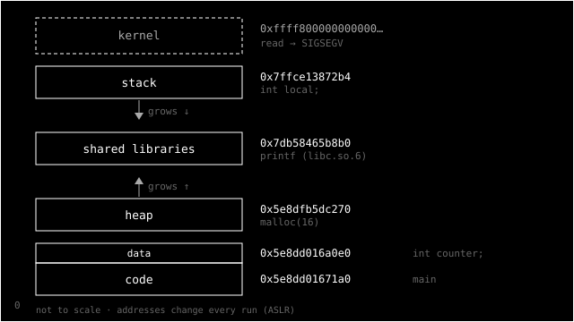

> **CSAPP series** — reading notes on _Computer Systems: A Programmer's Perspective_, one section
> at a time. Every post lives under [#csapp](/tags/csapp/). Previous:
> [§1.6 — The memory hierarchy](/posts/csapp-1-6-memory-hierarchy/).
> _[Leia em português](/posts/csapp-1-7-o-sistema-operacional/)._

In [section 1.4](/posts/csapp-1-4-the-processor/), the shell loaded `hello` and `hello` printed its
message. But neither of them touched the keyboard, the screen, the disk or memory directly. The
**operating system** did that for them. Section 1.7 explains what it is, and this post covers its four
subsections: processes, threads, virtual memory and files.

## What the book says

The operating system is a layer of software between applications and hardware. Every access to the
hardware goes through it, and it has two purposes:

1. **Protect** the hardware from misbehaving applications.
2. Give applications a **simple and uniform** way to use complicated and very different hardware.

To do that, it offers three abstractions. **Files** represent I/O devices. **Virtual memory**
represents main memory and the disk. And **processes** represent the processor, memory and I/O
together.

**Processes (1.7.1).** When `hello` runs, the operating system gives it the illusion of being the
only program on the machine: the CPU, memory and devices seem to belong to it alone. A process is the
abstraction of a running program, and the book calls it one of the most important and successful
ideas in computer science. Several processes run **concurrently**, with the instructions of one
interleaved with those of another. To switch between them, the system performs a **context switch**:
it saves the state of the current process (PC, registers, memory), restores the state of the next one
and hands control to it. This is done by the **kernel**, the part of the system that always stays in
memory. An application asks the kernel for something through a **system call**. And a detail the book
makes a point of: the kernel is not a process. It is the code and data structures that manage all the
processes.

**Threads (1.7.2).** A process can have several flows of execution, called **threads**, which run in
the context of the same process and share its code and global data. Sharing data between threads is
easier than between processes, and threads are usually lighter.

**Virtual memory (1.7.3).** Each process has the illusion of using main memory alone. They all see
the same **virtual address space**, laid out the same way: from bottom to top, the program's code and
data, the heap (which grows with `malloc`), shared libraries, the stack (which grows with each
function call) and, at the top, kernel memory, which the application cannot access. Underneath, the
hardware translates every address, and main memory acts as a cache for the disk.

**Files (1.7.4).** A file is a sequence of bytes, _nothing more and nothing less_. Every I/O device
(disk, keyboard, display and even the network) is treated as a file, and all I/O is done with a small
set of system calls: **Unix I/O**.

The section also has an aside on the history of Unix. It was born in 1969, when Bell Labs left the
Multics project, which it found too complex. Ken Thompson, Dennis Ritchie, Doug McIlroy and Joe
Ossanna started a simpler system on a PDP-7, and in 1970 Brian Kernighan named it "Unix", a pun on
"Multics". Then came BSD, System V and, to rein in the incompatibilities, the **Posix** standard.

## Checking it myself

### Same address, different values

This program creates a child process with `fork`. The child changes a global variable and both print
its address and value:

```c
int counter = 0;

pid_t pid = fork();
if (pid == 0) {
    counter = 7;
    printf("child:  &counter = %p, counter = %d\n", (void *)&counter, counter);
    _exit(0);
}
waitpid(pid, NULL, 0);
printf("parent: &counter = %p, counter = %d\n", (void *)&counter, counter);
```

```text
child:  &counter = 0x5e8dd016a0e0, counter = 7
parent: &counter = 0x5e8dd016a0e0, counter = 0
```

The **same address** holds **different values** in each process. That is virtual memory: each
process has its own address space, and the same virtual address points to different places in
physical memory. Replacing the `fork` with a thread that does `counter = 42`, `main` sees 42, because
threads share the process's memory.

### The real address space

The same program prints where a few things live in memory:



The order is exactly the one in the book's Figure 1.13: code, data, heap, libraries, stack. The
addresses change on every run, because Linux randomizes the positions (ASLR) to make attacks harder.
And the program's last line tries to read a kernel address:

```text
read 0xffffffff81000000 -> SIGSEGV
```

The hardware refuses, and the kernel delivers a segmentation fault signal to the process. That is the
first purpose, protection, at work.

### fork copied the buffer too

A surprise: when I ran the program with output going to a pipe, the first lines showed up
**twice**. In [section 1.4](/posts/csapp-1-4-the-processor/) we saw that, on a pipe, `printf` just
fills a libc buffer, and the text is only written later. `fork` copies the whole memory of the
process, and that includes this buffer with the text not yet written. Parent and child both ended up
printing it. An `fflush(stdout)` before `fork` fixes it.

It is a good example of abstractions rubbing against each other. The buffer is a libc detail, `fork`
is a kernel detail, and the bug only appears where they meet.

### What the illusion costs

| Operation                                                   | Cost        |
| ----------------------------------------------------------- | ----------- |
| an empty system call (`getppid`)                            | ~135 ns     |
| round trip between two processes on the same CPU, via pipes | ~4.4 µs     |
| creating a process that runs `hello` from start to finish   | ~700–900 µs |

A system call costs about as much as 300 register additions. That is why libc collects text in a
buffer before calling `write`: fewer calls, less cost. And creating a process costs almost a
millisecond, the same as about eight random reads from the SSD.

### Everything is a file

In bash, you can open a TCP connection as if it were a file:

```text
$ exec 3<>/dev/tcp/1.1.1.1/80
$ ls -l /proc/$$/fd/3
/proc/13824/fd/3 -> socket:[42793]
$ printf 'GET / HTTP/1.0\r\nHost: 1.1.1.1\r\n\r\n' >&3
$ head -1 <&3
HTTP/1.1 301 Moved Permanently
```

And it doesn't stop at the network. This laptop's battery level is a file
(`/sys/class/power_supply/BAT*/capacity` → `93`), a process's state is a file (`/proc/self/status`),
and so are random numbers (`/dev/urandom`). None of them exists on disk.

## The operating system makes illusions

This is the philosophical part.

The book's three abstractions are three illusions. A process is the illusion of having the CPU to
yourself. Virtual memory is the illusion of having memory to yourself. A file is the illusion that
every device is a sequence of bytes. Right now, this laptop keeps 346 processes and 929 threads
running on 12 CPUs, and each one of them believes it is alone.

They are useful lies, and what makes them useful is that they are **consistent**. A program written
for the illusion works without knowing what is underneath. `hello` doesn't know whether it is writing
to a terminal, a file or a pipe. It also doesn't know which physical address its variables are at, or
how many other programs are running.

It is also striking that **protection and simplicity are the same mechanism**. The system call that
stops one program from touching another's hardware is the same door that makes hardware access
simple. You can't have one without the other.

And Unix was born as a reaction against complexity. Its name is a joke about Multics. More than 50
years later, its most influential idea is still the simplest one: treat everything as a file, with
four operations (`open`, `read`, `write`, `close`). That is why a pipeline like
`cat log | grep error | wc -l` works: each program reads and writes bytes without knowing who is on
the other side.

## The illusions leak too

The pragmatic side: all these abstractions have costs and edges.

- **Context switches cost.** A server with thousands of threads can spend more time switching between
  them than working. That explains models like event loops and `io_uring`.
- **System calls cost.** Reading a file one byte at a time is much slower than reading in blocks.
  Buffers exist for this.
- **`fork` copies everything**, including buffers and state you didn't expect. Flush buffers first.
- **Addresses change on every run.** Never depend on a memory address across runs.

## Takeaways

1. Every call to `read`, `write`, `open` and friends crosses the boundary into the kernel. Batch work
   into fewer calls when performance matters.
2. Processes isolate and threads share. Choose based on what you want to be common.
3. "Everything is a file" is a tool. `/proc`, `/sys` and `/dev` show a lot about the system with no
   special tools.

Next stop: [1.8](/posts/csapp-1-8-networks/), where the network becomes just another I/O device.
